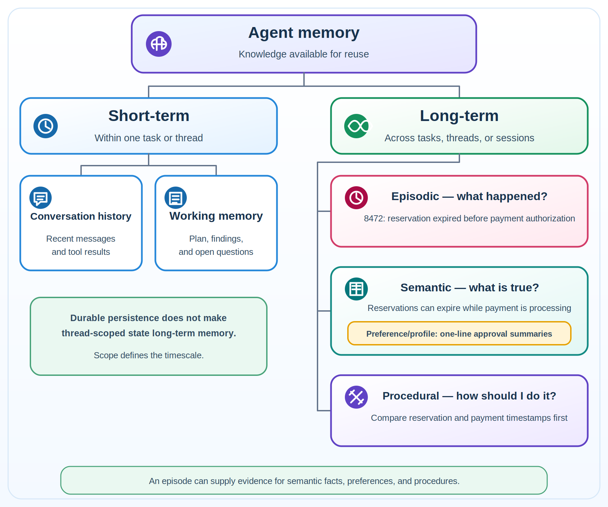
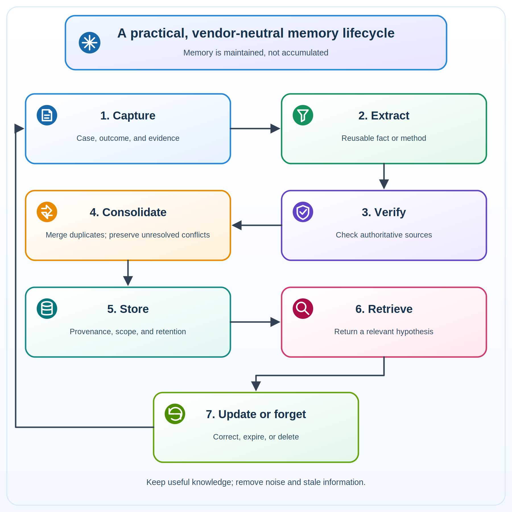

# Agent Memory: How Agents Learn Without Starting Over

_This is Part 5 of the **From Models to Harnesses** series, continuing from
[Part 1: From Models to Harnesses](https://www.linkedin.com/pulse/from-models-harnesses-how-ai-agents-learn-finish-job-penumatsa-g2mjc),
[Part 2: Agent Frameworks](https://www.linkedin.com/pulse/agent-frameworks-model-can-answer-workflow-finish-penumatsa-sdz6c),
[Part 3: Agent Harnesses](https://www.linkedin.com/pulse/agent-harnesses-giving-agents-place-work-praveen-varma-penumatsa-1tmwf),
and
[Part 4: Runtime Infrastructure](https://www.linkedin.com/pulse/runtime-infrastructure-give-your-agent-computer-badge-penumatsa-nlntc/).
You don't need the earlier parts to follow this story._

## 1. The agent solved the problem—then forgot the lesson

At the end of Part 4, order 8472 was resolved. The payment had been authorized,
but the order was not confirmed. The agent found the cause: the inventory
reservation expired before payment authorization. The on-call manager approved
the fix, the workflow resumed, and the business system recorded the result.

The runtime restored the workspace after the overnight pause. The workflow kept
the approval and progress. Those mechanisms helped the same case continue. They
did not teach the next case anything.

A month later, order 9315 gets stuck in a similar way. A fresh workspace starts.
The agent checks the payment, reads the order, and searches the logs. It has no
lesson from order 8472, so it starts from scratch.

**This is the gap memory fills.** Agent memory keeps selected knowledge from past
work so the system can use it again. Here, _learning_ means changing what the
agent can recall and apply. It does not require changing the model's weights.

## 2. Memory is not context, state, or a workspace

Start with order 9315. The business system says what is true now: the payment is
authorized and the order is not confirmed. Workflow state says where the case is:
which checks ran, whether approval is pending, and what can happen next. The
workspace holds files, scripts, notes, and artifacts. Memory suggests what past
knowledge may help.

> **Business state is current truth. Workflow state is current progress. A
> workspace holds working artifacts. Memory carries reusable knowledge. Context
> is the temporary selection the model sees now.**

The harness builds that context from instructions, recent messages, tool results,
current state, and retrieved memories. These concepts may use the same database,
but they do different jobs. A checkpoint can resume a workflow. A memory can
guide a later investigation. Neither replaces the live order record or grants
permission to act.

**Figure 1. From durable sources to temporary context**

## 3. Two timescales of agent memory

Agent memory operates at two timescales:

> **Current task or thread → conversation history + working memory. Across tasks
> or sessions → episodic + semantic + procedural memory.**

**Figure 2. Two timescales of agent memory**

Short-term memory keeps one task or conversation coherent:

- **Conversation history — what was just said or done?** It contains recent
  messages and tool results.
- **Working memory — what are we doing now?** It contains the current plan,
  findings, and open questions.

For order 9315, working memory might hold a note to compare payment and
reservation times. Frameworks often persist this thread-scoped information as
state or checkpoints.

Long-term memory crosses tasks or sessions.
[Three common forms](https://docs.langchain.com/oss/python/concepts/memory)
answer different questions:

- **Episodic memory — what happened?** It retains a specific situation, the
  actions taken, and the outcome.
- **Semantic memory — what is true?** It retains facts, concepts,
  relationships, and profiles.
- **Procedural memory — how should I do it?** It retains reusable methods,
  instructions, and strategies.

**A preference is usually semantic or profile memory, not episodic memory.** An
episode may provide the evidence from which the preference is learned.

Order 8472 shows how one case can produce several memories:

- **Episode:** Order 8472 failed after its reservation expired before payment
  authorization.
- **Semantic fact:** Reservations can expire while payment is still processing.
- **Procedure:** Compare reservation and payment timestamps first.
- **Preference/profile fact:** The on-call manager prefers a one-line summary
  with every approval request.

The categories can overlap across systems, but this distinction helps us decide
what to store and how to retrieve it.

## 4. The memory lifecycle: keep less, keep better

After order 8472, what should the agent keep? The useful parts are the verified
cause, the evidence that supports it, and the checks that worked. Keeping every
log line would make later retrieval slower, noisier, and harder to govern.

A practical, vendor-neutral memory lifecycle has seven steps:

1. **Capture a candidate.** Record the case outcome, useful evidence, and method
   that worked.
2. **Extract the lesson.** Keep the reusable part, not every message or log line.
3. **Verify before promotion.** Use authoritative records or review before a
   candidate becomes trusted memory.
4. **Consolidate carefully.** Merge duplicates, but keep unresolved conflicts
   visible.
5. **Store with controls.** Attach provenance, time, scope, owner, and retention.
6. **Retrieve as a hypothesis.** Rank relevant memories and check them against
   the current case.
7. **Update or forget.** Correct stale items, expire them, or delete them when
   required.

**Figure 3. A practical, vendor-neutral memory lifecycle**

A useful memory record needs more than text. It needs a source, timestamp, scope,
owner, retention rule, and status such as candidate or verified. Users and
operators also need a way to inspect, correct, and delete it. When two memories
disagree, the system should preserve the conflict until current evidence resolves
it.

## 5. Where memory fits in the harness

The harness connects the memory lifecycle to the agent loop. After a verified
case, it can send a candidate lesson to a memory service. The write can happen
in the main interaction or later in a background process. The service then
applies the provenance, scope, and retention controls from Section 4.

> **Work → candidate memory → verify and scope → store → retrieve and rank →
> context**

During later work, retrieval finds and ranks relevant items. The context builder
decides which of them fit the next model call. Trimming messages, summarizing
older content, and compacting history manage context; they are not extra memory
types.

Retrieved memory is still untrusted input. It can be stale, incorrectly scoped,
or corrupted. It may guide a decision, but it cannot grant authority or bypass
business rules and verification.

## 6. Back to order 9315

For order 9315, memory changes the first move, not the standard of proof. The
harness retrieves the verified lesson from order 8472: compare the inventory
reservation time with the payment authorization time.

The agent now follows a shorter path:

1. Retrieve the relevant lesson.
2. Compare it with the current order, inventory, and payment records.
3. If the evidence matches, follow the normal approval, repair, idempotency, and
   verification path. If it does not, investigate another cause.
4. Record the verified outcome so the memory can be strengthened, corrected, or
   kept separate.

> **Memory shortened the search. It did not prove the diagnosis. Memory proposes
> a useful hypothesis; current evidence decides.**

## 7. Mapping the concepts to Microsoft Foundry

Microsoft Foundry Agent Service provides
[managed long-term memory in preview](https://learn.microsoft.com/azure/foundry/agents/concepts/what-is-memory).
It also persists conversation and response state separately. Basic setup uses
Microsoft-managed resources. Standard setup stores thread and conversation state
in the customer's Azure Cosmos DB. This state remains short-term because it is
scoped to a conversation, even when it is stored durably. The
[Agent Service FAQ](https://learn.microsoft.com/azure/foundry/agents/faq)
explains the storage differences between basic and standard setup.

**Figure 4. How general memory concepts map to Microsoft Foundry**

Foundry's three long-term memory types overlap with the general taxonomy, but
they do not map one-to-one. A chat summary is a distilled summary of selected
prior conversations, not a complete episode, audit record, or workflow
checkpoint.

Foundry supports a memory search tool and
[lower-level Memory Store APIs](https://learn.microsoft.com/azure/foundry/agents/how-to/memory-usage).
The current preview includes item-level create, read, update, list, and delete
operations; store-level default retention; direct remember-or-forget commands;
and scope-based partitioning. When an application calls the APIs directly, it
must supply the scope explicitly. Scope separates memory collections; application
authentication and authorization still determine who may access them. Foundry's
extraction and consolidation automate memory management, but application
verification still determines whether a memory may influence a business action.
Preview behavior, limits, regions, and pricing can change.

Use memory for learned, reusable context;
[Foundry IQ](https://learn.microsoft.com/azure/foundry/agents/concepts/what-is-foundry-iq)
or Azure AI Search for curated organizational knowledge; framework checkpoints
for execution progress; and the system of record for business truth. In this
series' implementation, PostgreSQL is the authoritative business database for
the case, approval, and audit trail.

## 8. The agent can learn. How do we know its next decision is right?

By the time order 9315 closes, every layer in the series has contributed:

> **Model reasons → framework coordinates → harness supports long-horizon work →
> runtime executes and recovers → memory carries useful lessons forward**

Workflow state, business state, and the workspace allowed order 8472 to continue
after an interruption. Memory allowed the new order 9315 investigation to
benefit from that earlier work. Together, the layers carried a case across tools
and time to a verified outcome.

But a system that can finish work is not automatically a system we can trust.

Now the questions apply to the complete system:

- Did the model and framework choose a valid path and stop for required approval?
- Did the harness and runtime expose only permitted capabilities, recover
  correctly, and preserve the required evidence?
- Did memory retrieve properly scoped knowledge and remain subordinate to
  current business truth?
- Did the system produce the correct business outcome once, with evidence?

**Observability** supplies the evidence of what happened: model and tool calls,
state transitions, approval events, retrieved memory identifiers, runtime
failures, latency, and the final business result. It should expose safe decision
summaries, not hidden reasoning or sensitive raw data.

**Evaluations** turn that evidence into repeatable judgment. They replay known
cases, test different failure causes, compare behavior with and without memory,
inject failures, and create release gates. Observability tells us what happened.
Evaluations tell us whether it was correct and whether a change made the system
better.

Part 6 closes the loop:

> **Observe → evaluate → improve → release safely → monitor**

The first five parts built an agent system that can reason, coordinate, work
across time, run safely, and learn from past work. Part 6 asks whether the whole
system does those things correctly and consistently—and how to improve it when
it does not.

---

**References and further reading:**

_First-party documentation checked 15 October 2026._

- **Microsoft Foundry:** [Memory in Microsoft Foundry Agent Service (preview)](https://learn.microsoft.com/azure/foundry/agents/concepts/what-is-memory)
  · [Create and use memory](https://learn.microsoft.com/azure/foundry/agents/how-to/memory-usage)
  · [Agent Service frequently asked questions](https://learn.microsoft.com/azure/foundry/agents/faq)
- **Memory and context:** [LangChain and LangGraph memory overview](https://docs.langchain.com/oss/python/concepts/memory)
  · [LangChain context engineering](https://docs.langchain.com/oss/python/langchain/context-engineering)
  · [CoALA: Cognitive Architectures for Language Agents](https://arxiv.org/abs/2309.02427)
